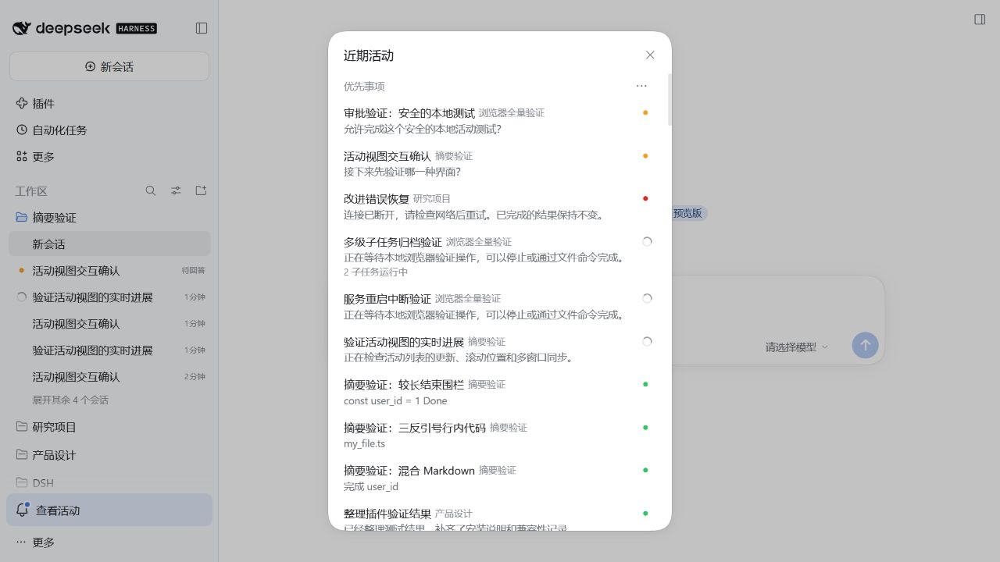

# BetterActivity

[English](README_EN.md) · 中文

通过 DSH 侧栏底部的铃铛查看近期活动。打开独立浮层，保留当前聊天和原生会话列表。

**0.2.0 可安装到原版 DSH 0.2.2-rc.2；用户无需修改 DSH 源码、应用补丁或重新构建。**



[深色界面](docs/images/activity-dark.png) · [窄窗口](docs/images/activity-narrow.png)

## 功能

- 点击“查看活动”或按 Ctrl+Alt+U 打开、关闭浮层。
- 优先显示待处理、未读失败、运行中与未读完成，其余按本地日期分组。
- 展示项目、公开助手摘要与状态；子任务归入有效父会话。
- 使用原生跳转和右键菜单；原生搜索会收起活动浮层并获得焦点。
- 当前正文收到对应结果，且前台未被遮挡时自动已读；支持全部已读和同一实例多窗口同步。
- 每个窗口独立保留开关、分页和滚动。活动视图不添加搜索功能。

## 安装

在所用 DSH 运行环境中安装本地预构建包：

```sh
dsh plugin --profile web add /path/to/dsh-better-activity-0.2.0.tgz
```

Windows 桌面可通过其插件管理安装同一 tgz。要求运行时为 DSH 0.2.2-rc.2、Node.js >=24.9.0。安装后刷新界面。预构建包由 [GitHub Actions](https://github.com/MakerFlyFly/DSH-better-activity/actions/workflows/ci.yml) 生成，可从成功运行的 Artifacts 下载；当前尚未发布 npm 包或 GitHub Release。

本轮完整验收覆盖官方 Web 运行时。Windows 桌面复验尚未完成，具体记录见下方验证说明。

[详细说明](packages/activity/README.md) · [兼容记录](packages/activity/compatibility.json) · [版本记录](CHANGELOG.md) · [验证记录](docs/VALIDATION.md)

## 开发与验证

开发工具与用户运行时分开。构建使用固定提交的独立 DSH 工具副本，只对该副本应用 scripts/patches/remote-generator.patch；这是生成外置 Remote 元数据所需的工具修复，不是用户安装步骤。不要把工具副本当作免补丁验证环境。

准备好工具副本的依赖和构建产物后：

```sh
node scripts/link-dsh.mjs /path/to/build-tools/deepseek-harness
node scripts/prepare-runtime.mjs /path/to/isolated-runtime
node scripts/build.mjs
node scripts/package.mjs
node node_modules/vitest/vitest.mjs run
node scripts/dev.mjs --fixture
```

测试和预览默认使用 prepare-runtime.mjs 安装的官方 npm 运行时与预构建 tgz，数据位于独立目录。原生宿主与用户的源码均不会被修改。

## 许可

[MIT](LICENSE)。保留已有版权归属。
