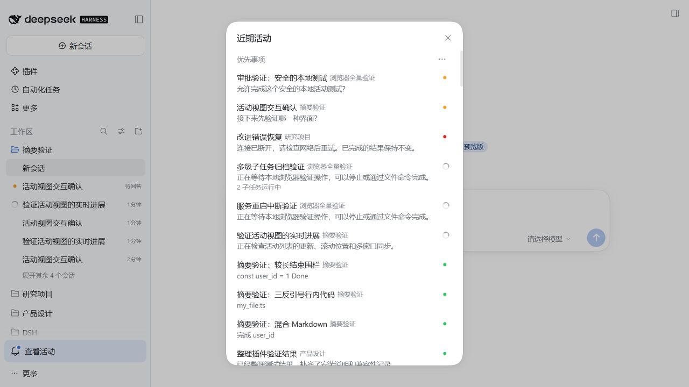

# BetterActivity

[](https://github.com/MakerFlyFly/DSH-better-activity/actions/workflows/ci.yml)
[](LICENSE)
[](packages/activity/compatibility.json)

English · [中文](README.md)

View recent DSH activity from the sidebar footer bell. The activity dialog preserves the current conversation and native conversation browser.

**Version 0.2.0 installs on unmodified DSH 0.2.2-rc.2. Users do not patch or rebuild DSH.**



[Dark theme](docs/images/activity-dark.png) · [Narrow viewport](docs/images/activity-narrow.png)

## Features

- Toggle with the bell or Ctrl+Alt+U. Close with Escape, the close button or the outside mask.
- Prioritize pending interactions, unread failures, running work and unread completions; group other conversations by local date.
- Show project names, public assistant summaries and status; aggregate child work under a valid parent.
- Keep native navigation and context menus. Native search closes the activity dialog and retains focus.
- Automatically acknowledge an outcome only after the current foreground conversation has received that exact end event and is unobscured. Read state is shared by windows on the same instance.
- Restore each window's visibility, pagination and scroll position. The activity view adds no search feature.

## Installation

1. Open [GitHub Actions](https://github.com/MakerFlyFly/DSH-better-activity/actions/workflows/ci.yml) and select the latest successful **Verify plugin** run on `main`.
2. Under **Artifacts**, download either the `better-activity-windows-latest` or `better-activity-ubuntu-latest` ZIP.
3. Extract the ZIP and locate `dsh-better-activity-0.2.0.tgz`.

Install the extracted `.tgz` using the CLI belonging to your DSH runtime:

```sh
dsh plugin --profile web add /path/to/dsh-better-activity-0.2.0.tgz
```

Windows desktop can install the same tgz through its plugin manager. Requires DSH 0.2.2-rc.2 and Node.js >=24.9.0. Refresh the interface after installation.

CI artifacts are retained for **7 days**. No npm package or GitHub Release has been published.

This acceptance run covers the official Web runtime. Windows desktop revalidation is incomplete; see the validation record below.

[Installation and behavior](packages/activity/README_EN.md) · [Compatibility](packages/activity/compatibility.json) · [Changelog](CHANGELOG.md) · [Validation](docs/VALIDATION.md)

## Development

Use an independent DSH build-tool checkout at the recorded source commit. Apply only scripts/patches/remote-generator.patch to that tool checkout and build it. This fixes metadata generation; it is not a user-runtime requirement. The official runtime used for installation tests is separate.

```sh
node scripts/link-dsh.mjs /path/to/build-tools/deepseek-harness
node scripts/prepare-runtime.mjs /path/to/isolated-runtime
node scripts/build.mjs
node scripts/package.mjs
node node_modules/vitest/vitest.mjs run
node scripts/dev.mjs --fixture
```

Tests and previews use the official npm runtime prepared above and a prebuilt tgz. They keep data in isolated directories. Source overrides are explicitly labeled coexistence tests and do not attest unmodified-runtime compatibility.

[MIT license](LICENSE), retaining the existing notices.
